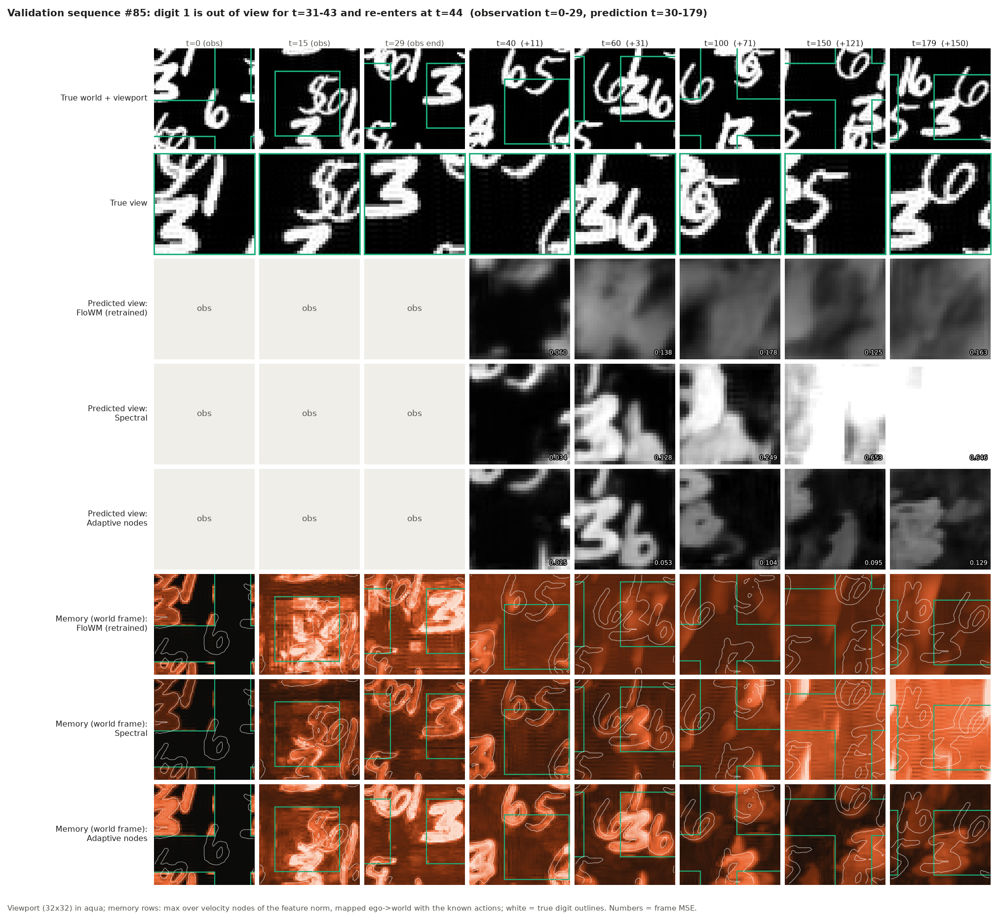
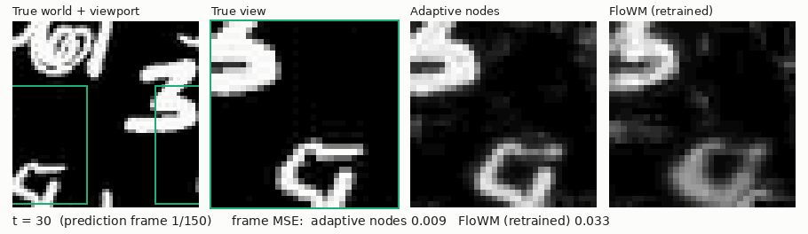
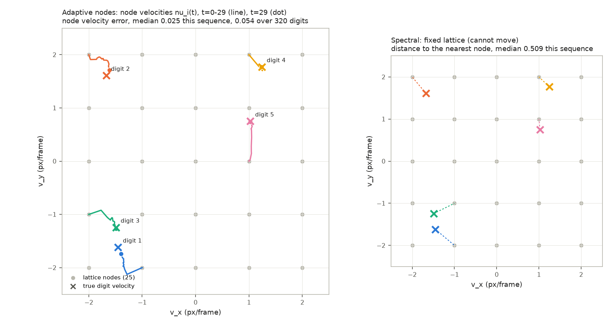

# Kinetic World Models

A world model with a latent memory that moves. The memory lives on the agent's
position grid and on a small set of velocities, as in Flow Equivariant World
Models (FloWM, Lillemark et al., ICML 2026). FloWM moves this memory by integer
pixels at integer velocities. This repository makes both continuous. The
memory shifts by real-valued amounts through a Fourier phase, and each velocity
channel tracks the real velocity of the object it holds. We test on FloWM's own
2D task with real-valued velocities and camera motion. There the published
FloWM weights fail on the first predicted frame and a retrained FloWM stays
blurry. The model here predicts 150 frames ahead without losing the objects.



*One validation sequence. The top row shows the full 50x50 world and the
agent's 32x32 viewport. The rows below show the true view, the predicted view
of three models, and each model's memory mapped back to world coordinates,
with the true digit outlines in white. The adaptive-node model keeps digits at
their true positions while they are out of view.*

## What is in the box

- An online 2D benchmark, Kinetic MNIST World. It follows FloWM's MNIST World
  with a 50x50 world, a 32x32 viewport, 5 digits, 30 or 50 observed frames
  and up to 150 predicted frames. It adds switches for real-valued digit velocities,
  real-valued camera motion, reflecting walls, and fractional time steps.
- A reimplementation of the 2D FloWM cell that matches the authors' code to
  within 1e-6, and a loader for their published checkpoint.
- Three models that differ only in how the memory moves: the FloWM cell, the
  same cell with spectral transport, and spectral transport with adaptive
  velocity nodes. See `docs/METHOD.md`.
- Evaluation of prediction error, long-horizon drift, velocity recovery,
  fractional-time prediction, and equivariance under real-valued boosts.
- The scripts and figures behind `docs/RESULTS.md`.

## Main result

Mean squared error of the predicted viewport on 300 validation sequences with
real-valued velocities and camera motion, averaged over the first 20 and over
the first 150 predicted frames. The models trained here have about 20k parameters, 32 hidden channels and
25 velocity nodes, and are trained for at most 20k steps at batch size 16.
The first row uses the authors' checkpoint, a 64-channel model trained on
integer data.

| Model | 20 frames | 150 frames |
|---|---|---|
| Published FloWM weights, used as is | 0.150 | 0.155 |
| FloWM, retrained on this data | 0.067 | 0.145 |
| Spectral transport only | 0.033 | 0.287 |
| Spectral transport + adaptive velocity nodes | 0.036 | 0.089 |
| Oracle: nodes set to the true velocities | 0.006 | 0.043 |
| Predict all zeros | 0.156 | 0.155 |

The oracle row is not a model. It shows what the same architecture reaches when
the velocity channels are aligned with the true velocities, and it sets the
target for the adaptive nodes.

Two more numbers say where the gain comes from. With real-valued camera motion
and integer object velocities, spectral transport alone reaches 0.0028 against
0.047 for FloWM. With integer camera motion and real-valued object velocities,
the fixed velocity lattice reaches 0.040 and the adaptive nodes 0.031 after
10k steps, and the gap grows with the horizon.



*150 predicted frames of the same sequence. From left to right: the true world
with the viewport, the true view, the prediction with adaptive nodes, and the
prediction of the retrained FloWM.*



*Left: during the 30 observed frames, each adaptive node (line) moves from its
lattice point to the true velocity of the digit it holds (cross). Right: the
fixed lattice of FloWM, where the nearest node is 0.4 pixel per frame away
from a digit's velocity on average.*

## Quick start

```bash
python -m venv .venv && source .venv/bin/activate
pip install -r requirements.txt
pytest -q
python -m kwm.train --model adaptive --real_velocity --real_camera --steps 20000 --out runs/adaptive
python -m kwm.eval --run runs/adaptive --n_val 300 --equiv_boost
```

`docs/REPRODUCE.md` lists the command for every table and figure.

## Layout

```
kwm/        environment, transport, model cells, training and evaluation
tests/      unit tests, including the match against the FloWM reference cell
scripts/    figure scripts and the published-checkpoint benchmark
docs/       METHOD.md, RESULTS.md, REPRODUCE.md
results/    figures and the numbers used in the documents
```

## References

- H. J. Lillemark, B. Huang, F. Zhan, Y. Du, T. A. Keller. Flow Equivariant
  World Models: Structured Memory for Dynamic Environments. ICML 2026.
  Code: github.com/hlillemark/flowm.
- T. A. Keller. Flow Equivariant Recurrent Neural Networks. NeurIPS 2025.

`tests/reference/flowm_models_2d.py` is the authors' file, kept under its MIT
license for the equivalence test. Everything else is MIT licensed, see
`LICENSE`.
